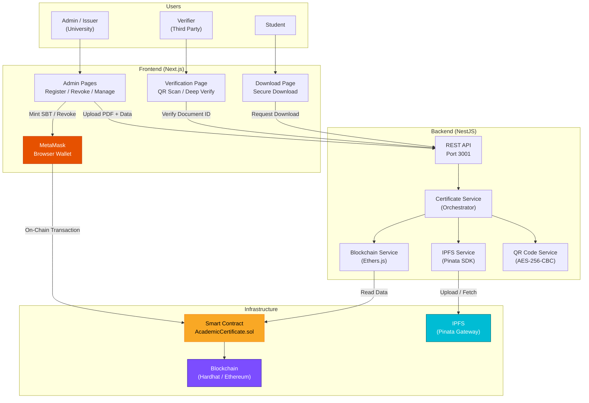
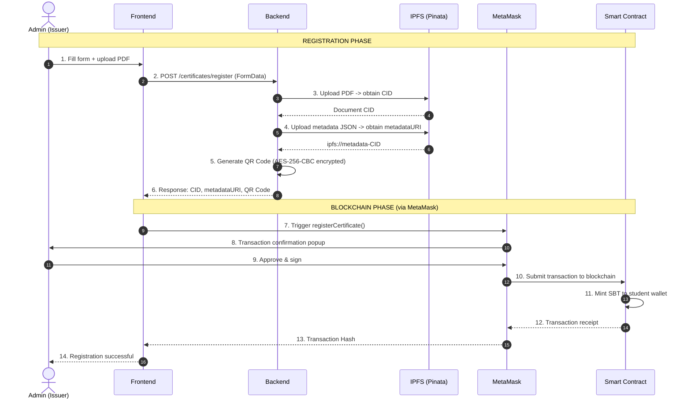
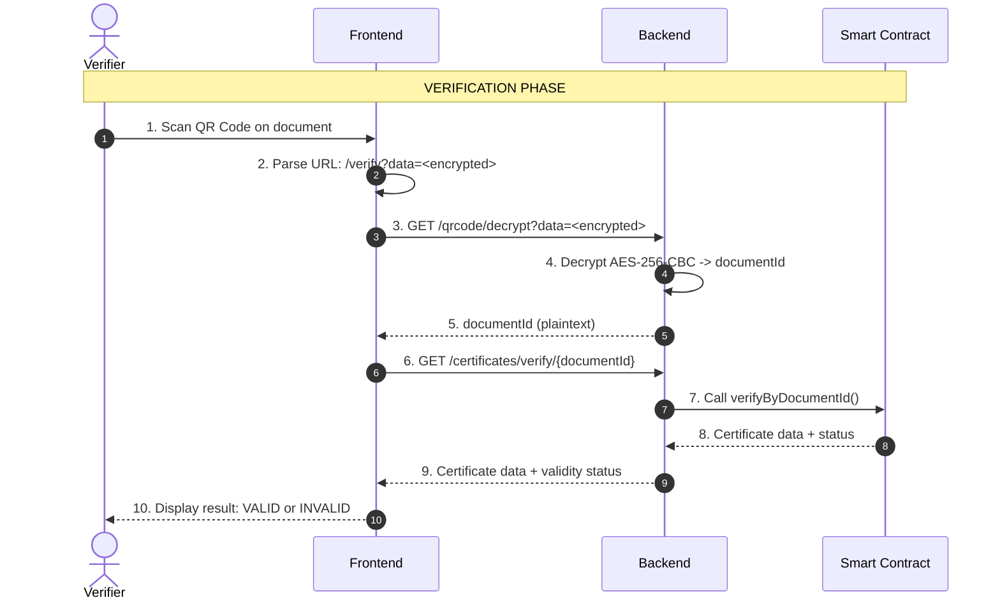
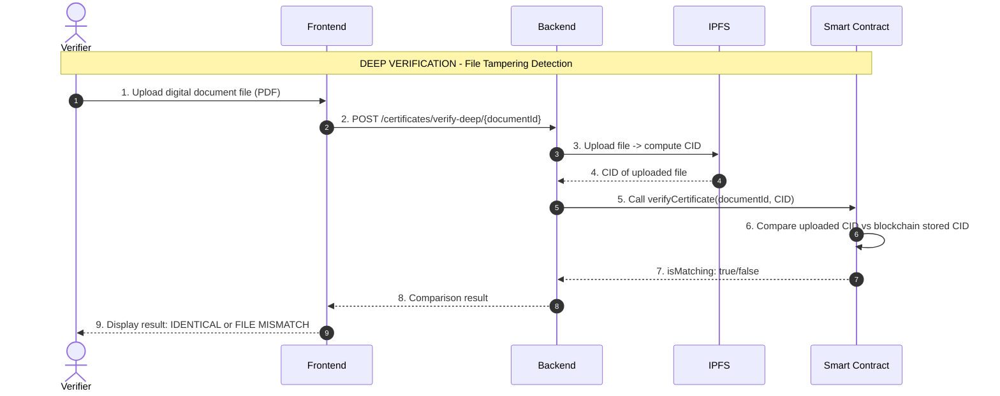
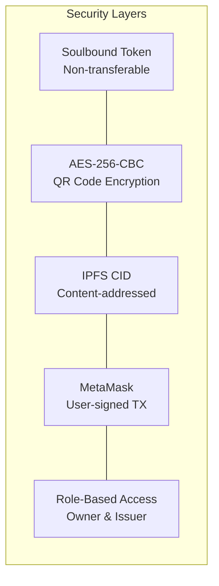

# Academic Credential Verification

> **Soulbound Token (SBT) × IPFS × Smart Contract**
>
> An academic document verification system (degrees, transcripts, certificates) leveraging blockchain technology and IPFS as a tamper-evident record of data integrity.

---

## Description

This system enables educational institutions to register academic documents onto the blockchain as **Soulbound Tokens (SBT)** — non-transferable NFTs. The original documents are stored decentrally on **IPFS** (InterPlanetary File System), while the cryptographic hash (CID) of each document is permanently recorded on the blockchain as proof of integrity.

Third parties (companies, government agencies, or other universities) can verify document authenticity by **scanning a QR Code** or entering the Document ID.

---

## System Architecture



---

## System Workflows

### 1. Certificate Registration Workflow



### 2. Certificate Verification Workflow (QR Code Scan)



### 3. Deep Verification Workflow (CID Hash Comparison)



---

## Project Structure

```
tugasAkhir1/
├── smartContract/          # Smart Contract (Solidity + Hardhat)
│   ├── contracts/
│   │   └── AcademicCertificate.sol   # Main contract (SBT)
│   ├── scripts/
│   │   ├── deploy.ts                # Deployment script
│   │   ├── register.ts              # Test registration script
│   │   ├── authorize.ts             # Issuer authorization script
│   │   └── revoke.ts                # Certificate revocation script
│   └── hardhat.config.ts            # Hardhat configuration
│
├── backend/                # Backend API (NestJS)
│   └── src/
│       ├── certificate/    # Main orchestrator
│       ├── ipfs/           # IPFS integration (Pinata)
│       ├── blockchain/     # Smart Contract integration
│       └── qrcode/         # QR Code + AES encryption
│
├── frontend/               # Frontend (Next.js)
│   ├── app/
│   │   ├── page.tsx                  # Public verification page
│   │   ├── verify/                   # QR verification redirect handler
│   │   ├── admin-qX9vM2pZ/          # Admin panel (obfuscated)
│   │   │   ├── register/            # Certificate registration form
│   │   │   ├── revoke/              # Certificate revocation
│   │   │   ├── manage/              # Staff / issuer management
│   │   │   └── stamper/             # PDF QR stamper
│   │   └── download/                # Secure download
│   └── lib/
│       ├── api.ts          # Backend API client
│       ├── web3.ts         # MetaMask integration
│       └── contract.ts     # Contract ABI + address
│
└── README.md               # Current document
```

---

## Getting Started

### Prerequisites

| Software | Minimum Version | Purpose |
|----------|-----------------|---------|
| **Node.js** | v18+ | JavaScript runtime |
| **npm** | v9+ | Package manager |
| **MetaMask** | Latest | Browser wallet extension |
| **Pinata Account** | - | IPFS pinning service |

### Step 1: Clone Repository

```bash
git clone <repository-url>
cd tugasAkhir1
```

### Step 2: Run Smart Contract (Local Blockchain)

```bash
cd smartContract
npm install

# Terminal 1 - Run local blockchain node
npx hardhat node

# Terminal 2 - Deploy contract
npx hardhat run scripts/deploy.ts --network localhost
```

> **Important:** Note the `Contract Address` displayed after deployment. You must add it to the `.env` files in both the backend and frontend.

### Step 3: Run Backend

```bash
cd backend
npm install

# Copy and configure environment variables
cp .env.example .env
# Edit .env -> specify CONTRACT_ADDRESS, PINATA_JWT, etc.

npm run start:dev
```

Backend runs at `http://localhost:3001`  
Swagger API Docs: `http://localhost:3001/api`

### Step 4: Run Frontend

```bash
cd frontend
npm install

# Edit .env.local -> specify NEXT_PUBLIC_CONTRACT_ADDRESS
npm run dev
```

Frontend runs at `http://localhost:3000`

### Step 5: Configure MetaMask

1. Install MetaMask in your browser.
2. Import one of the test accounts from the Hardhat node (use a private key output by `npx hardhat node`).
3. Add a custom network:
   - **Network Name:** Hardhat Local
   - **RPC URL:** `http://127.0.0.1:8545`
   - **Chain ID:** `31337`
   - **Currency Symbol:** ETH

---

## System Security



| Layer | Mechanism | Description |
|---|---|---|
| **Document Integrity** | IPFS CID | Any modification to the file produces a different CID |
| **On-Chain Authenticity** | Soulbound Token | SBT cannot be transferred; only minted and burned |
| **QR Code Encryption** | AES-256-CBC | Document ID is encrypted before being embedded in the QR Code |
| **Transaction Authorization** | MetaMask Signing | Every state-changing transaction requires explicit user signature |
| **Access Control** | Smart Contract Modifiers | Only Owner / Issuer can register or revoke certificates |
| **Secure Download** | Triple Verification | Document ID + Student ID + Student Wallet must all match |

---

## Tech Stack

| Layer | Technology | Version |
|---|---|---|
| **Smart Contract** | Solidity + Hardhat 3 + OpenZeppelin | ^0.8.28 |
| **Backend** | NestJS + Ethers.js + Pinata SDK | v11 |
| **Frontend** | Next.js + React + Ethers.js + Framer Motion | v16 |
| **Blockchain** | Ethereum (Hardhat Local / Sepolia / Polygon Amoy) | - |
| **Storage** | IPFS via Pinata | - |
| **Wallet** | MetaMask | - |

---

## Further Documentation

| Component | README | Description |
|---|---|---|
| Smart Contract | [`smartContract/README.md`](./smartContract/README.md) | SBT architecture, contract functions, role management |
| Backend | [`backend/README.md`](./backend/README.md) | API endpoints, IPFS integration, QR Code encryption |
| Frontend | [`frontend/README.md`](./frontend/README.md) | MetaMask integration, application pages, UI flows |

---