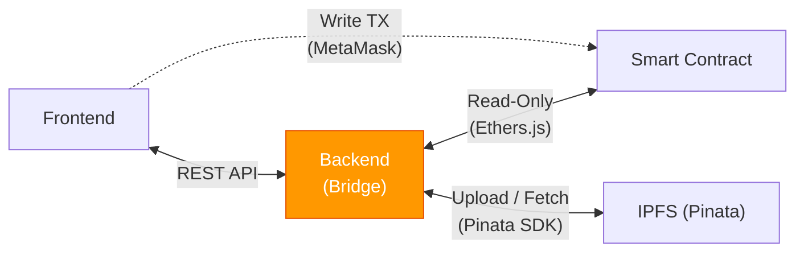
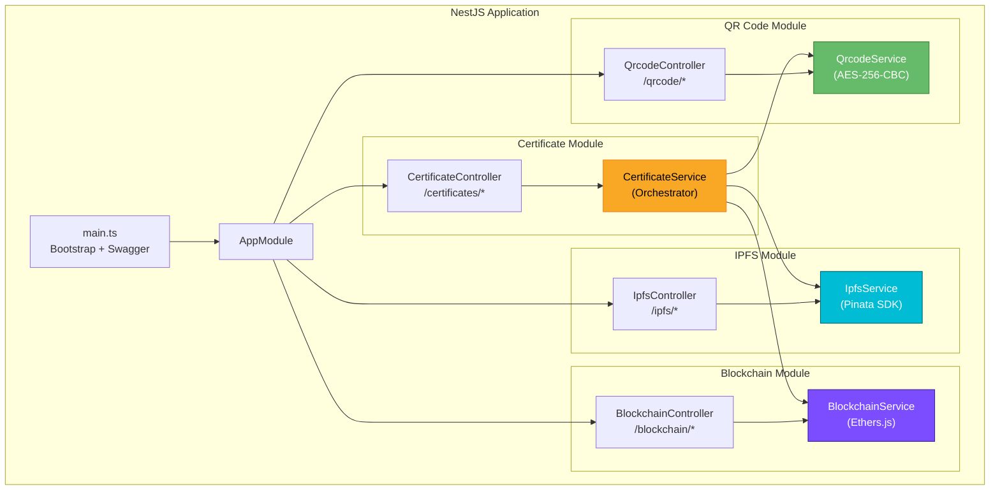
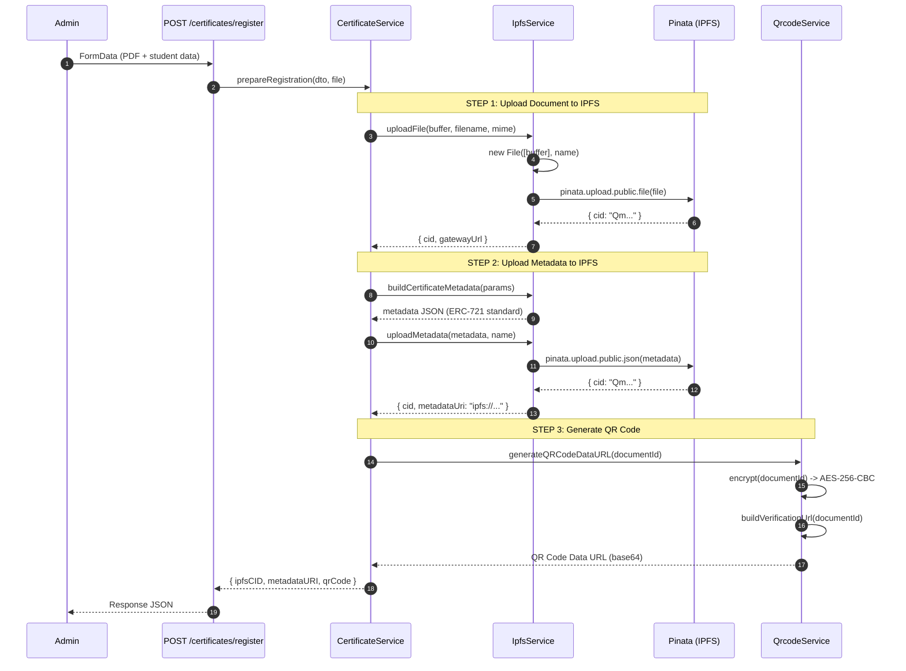
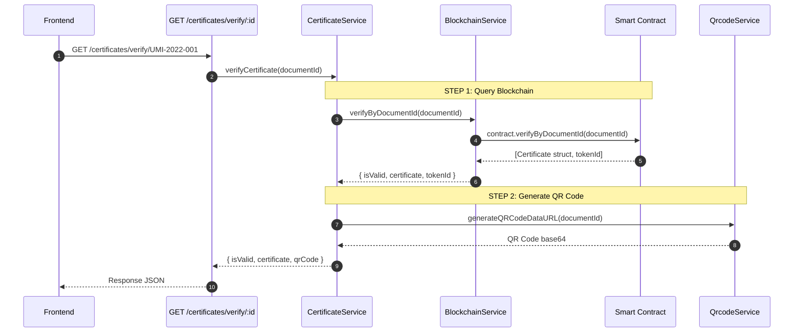
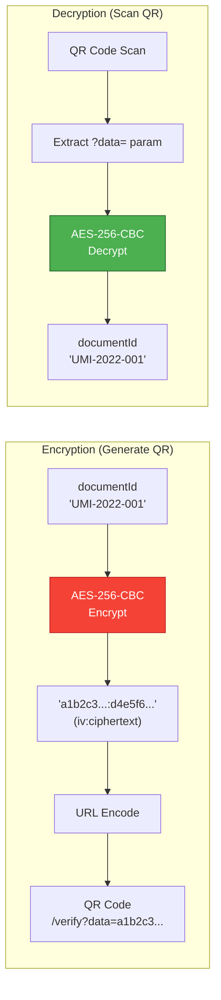
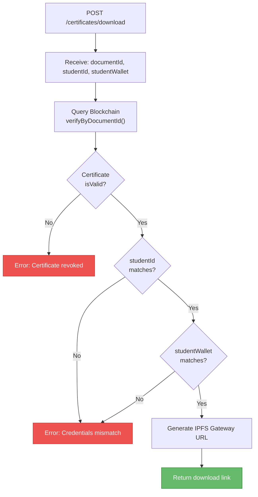

# Backend

> The backend serves as the **bridge** between the Frontend and the Smart Contract, while managing decentralized file storage on IPFS.
> Built with **NestJS** (TypeScript).

---

## Backend Role in the System

The backend **does not** execute blockchain transactions directly (it holds no private keys for write operations). Instead, it functions as:



| Task | Description |
|---|---|
| **IPFS Manager** | Uploads PDF documents and metadata JSON to IPFS via Pinata |
| **Blockchain Reader** | Reads certificate data from the smart contract (call / view operations) |
| **QR Code Generator** | Generates QR Codes with AES-256-CBC encryption |
| **Orchestrator** | Coordinates the entire registration and verification workflow |

> **Note:** **Write transactions** (minting SBT, revoking) are executed **directly from the frontend via MetaMask**, not from the backend.

---

## Module Architecture



---

## API Endpoints

### Certificate API (`/certificates`)

| Method | Endpoint | Description |
|---|---|---|
| `POST` | `/certificates/register` | Upload PDF to IPFS, generate metadata, create QR Code |
| `GET` | `/certificates/verify/:documentId` | Verify certificate (QR Code scan) |
| `POST` | `/certificates/verify-deep/:documentId` | Deep verify: upload file and compare CID |
| `POST` | `/certificates/download` | Secure download (3-factor credential verification) |

### QR Code API (`/qrcode`)

| Method | Endpoint | Description |
|---|---|---|
| `GET` | `/qrcode/:documentId` | Generate QR Code (base64 data URL) |
| `GET` | `/qrcode/:documentId/download` | Download QR Code (PNG) |
| `GET` | `/qrcode/:documentId/svg` | Generate QR Code (SVG) |
| `GET` | `/qrcode/decrypt?data=...` | Decrypt QR Code data |

### Blockchain API (`/blockchain`)

| Method | Endpoint | Description |
|---|---|---|
| `GET` | `/blockchain/stats` | Blockchain statistics (total certificates) |
| `GET` | `/blockchain/contract-info` | Contract information (ABI + address) |

### Swagger Documentation

After starting the backend, access interactive API documentation at:
```
http://localhost:3001/api
```

---

## Detailed Process Workflows

### Registration — How Documents Are Stored on IPFS



### Metadata JSON Stored on IPFS

```json
{
  "name": "Academic Certificate - Mugni Adji",
  "description": "Academic certificate S1 Teknik Informatika issued by UMI",
  "image": "ipfs://QmDocumentCID...",
  "external_url": "ipfs://QmDocumentCID...",
  "attributes": [
    { "trait_type": "Document ID", "value": "UMI-2022-13020220166" },
    { "trait_type": "Student Name", "value": "Mugni Adji" },
    { "trait_type": "Student ID (NIM)", "value": "13020220166" },
    { "trait_type": "Degree", "value": "S1" },
    { "trait_type": "Major", "value": "Teknik Informatika" },
    { "trait_type": "Issuer", "value": "Universitas Muslim Indonesia" },
    { "display_type": "date", "trait_type": "Issued At", "value": "2024-01-15T..." }
  ]
}
```

### Verification — How Data Is Read from the Blockchain



---

## QR Code Encryption (AES-256-CBC)

The QR Code **does not** contain the Document ID in plaintext. Instead, the Document ID is encrypted using **AES-256-CBC** before being embedded in the QR Code.



| Component | Detail |
|---|---|
| **Algorithm** | AES-256-CBC |
| **Key** | SHA-256 hash of `AES_SECRET_KEY` environment variable (32 bytes) |
| **IV** | Random 16 bytes (unique per encryption) |
| **Output Format** | `{iv_hex}:{ciphertext_hex}` |

---

## Secure Download — Triple Verification



---

## Getting Started

### 1. Install Dependencies

```bash
cd backend
npm install
```

### 2. Configure Environment Variables

```bash
cp .env.example .env
```

Edit the `.env` file:

```env
# Server
PORT=3001

# Pinata / IPFS
PINATA_JWT=your_pinata_jwt_token_here
PINATA_GATEWAY=your-gateway.mypinata.cloud

# Blockchain
BLOCKCHAIN_RPC_URL=http://127.0.0.1:8545
CONTRACT_ADDRESS=0x_deployed_contract_address_here

# Frontend
FRONTEND_URL=http://localhost:3000
VERIFICATION_BASE_URL=http://localhost:3000/verify

# QR Code Encryption
AES_SECRET_KEY=your-secret-key-here
```

### 3. Run the Development Server

```bash
npm run start:dev
```

Backend runs at `http://localhost:3001`

### 4. Access Swagger

Visit `http://localhost:3001/api` to view and interactively test all API endpoints.

---

## Source Code Structure

```
backend/src/
├── main.ts                          # Bootstrap + Swagger setup
├── app.module.ts                    # Root module (imports all submodules)
│
├── certificate/                     # Main Orchestrator Module
│   ├── certificate.module.ts
│   ├── certificate.controller.ts    # REST endpoints /certificates/*
│   ├── certificate.service.ts       # Business logic (orchestrator)
│   └── dto/
│       └── certificate.dto.ts       # Input validation (class-validator)
│
├── ipfs/                            # IPFS Module (Pinata)
│   ├── ipfs.module.ts
│   ├── ipfs.controller.ts           # REST endpoints /ipfs/*
│   └── ipfs.service.ts              # File and metadata upload to Pinata
│
├── blockchain/                      # Blockchain Module (Read-Only)
│   ├── blockchain.module.ts
│   ├── blockchain.controller.ts     # REST endpoints /blockchain/*
│   ├── blockchain.service.ts        # Smart contract interaction
│   └── abi/
│       └── AcademicCertificate.json # Contract ABI (copied from artifacts)
│
└── qrcode/                          # QR Code & Encryption Module
    ├── qrcode.module.ts
    ├── qrcode.controller.ts         # REST endpoints /qrcode/*
    └── qrcode.service.ts            # QR generation + AES-256-CBC
```

---

## Key Dependencies

| Package | Version | Purpose |
|---|---|---|
| `@nestjs/core` | ^11.0.1 | Backend framework |
| `@nestjs/swagger` | ^11.3.2 | Swagger API documentation |
| `ethers` | ^6.16.0 | Blockchain interaction (read-only) |
| `pinata` | ^2.5.5 | IPFS upload SDK |
| `qrcode` | ^1.5.4 | QR Code generation |
| `class-validator` | ^0.15.1 | DTO validation |
| `multer` | ^2.1.1 | File upload handling (multipart/form-data) |

---

## Testing

```bash
# Unit tests
npm run test

# E2E tests
npm run test:e2e

# Test coverage
npm run test:cov
```
