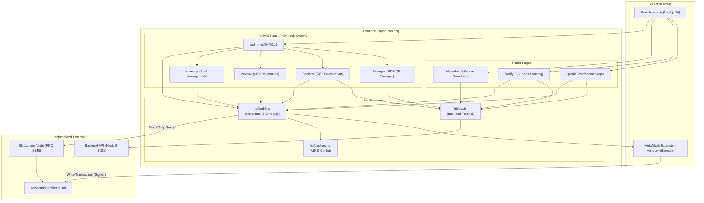
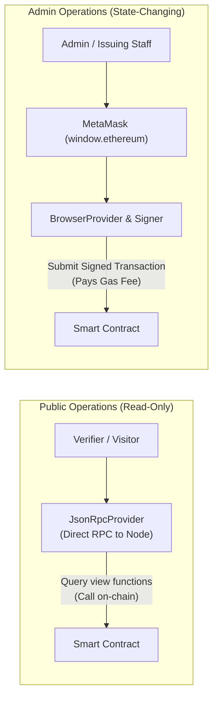
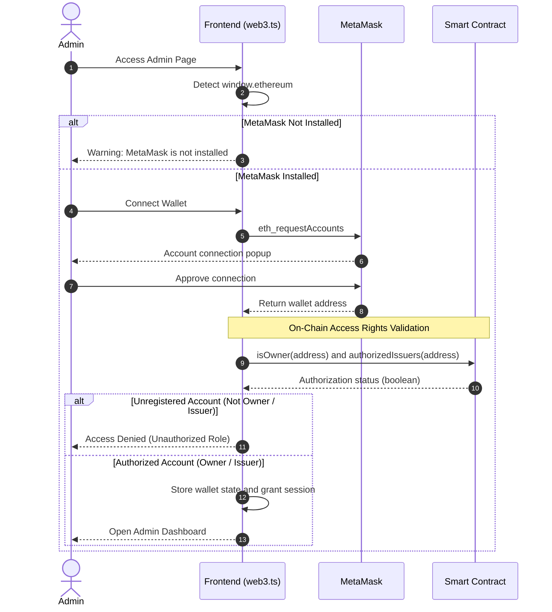
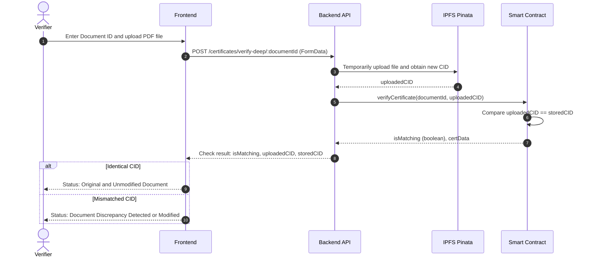
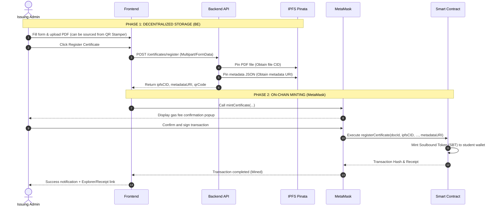

# Frontend

> Web application built with **Next.js (App Router)** serving as the user interface for public academic document verification, secure downloads, and a Web3-based administration panel for issuing Soulbound Token (SBT) certificates.

---

## Overview

This frontend is designed for two primary audiences:
1. **Public and Verifiers**: Verify document authenticity using Document ID, QR Code scanning, or PDF file upload (Deep Verification) without requiring Web3 wallet authentication.
2. **Academic Issuers (Admin / Staff)**: Access a protected panel using a **Web3 wallet (MetaMask)** to stamp QR Codes onto PDFs (QR Stamper), upload to IPFS, and sign on-chain transactions for minting and revoking SBT certificates.

---

## Frontend Architecture



---

## Deep Integration with MetaMask

Web3 integration in this frontend is implemented using **Ethers.js (v6)** via the [`lib/web3.ts`](./lib/web3.ts) module.

### 1. Dual-Provider Architecture

The system strictly differentiates between **Read-Only** operations and **State-Changing / Write** operations (which require gas fees and wallet signatures):



- **`JsonRpcProvider`**: Allows the frontend to check certificate status, verify data, and read total certificates directly from the public blockchain without requiring verifiers to install the MetaMask extension.
- **`BrowserProvider` (via `window.ethereum`)**: Used exclusively on the administration panel to request cryptographic signatures from authorized Issuers when minting or burning tokens.

---

### 2. MetaMask Wallet Detection and Connection Flow



### 3. Core Integration Code Logic (`lib/web3.ts`)

#### A. Account Detection and Access Request
```typescript
export function isMetaMaskInstalled(): boolean {
  return typeof window !== 'undefined' && !!window.ethereum?.isMetaMask;
}

export async function connectWallet(): Promise<string> {
  if (!isMetaMaskInstalled()) {
    throw new Error('MetaMask is not installed. Please install MetaMask.');
  }

  const accounts = (await window.ethereum!.request({
    method: 'eth_requestAccounts',
  })) as string[];

  return accounts[0];
}
```

#### B. Signer vs. Read-Only Contracts
```typescript
// Read-only (No wallet interaction required)
export function getReadOnlyContract(): Contract {
  const provider = new JsonRpcProvider(RPC_URL);
  return new Contract(CONTRACT_ADDRESS, CONTRACT_ABI, provider);
}

// Signer (Requires MetaMask authorization)
export async function getSignerContract(): Promise<Contract> {
  const provider = new BrowserProvider(window.ethereum!);
  const signer = await provider.getSigner();
  return new Contract(CONTRACT_ADDRESS, CONTRACT_ABI, signer);
}
```

#### C. On-Chain Role Checking
Every connected wallet is verified directly against the smart contract functions:
```typescript
export async function hasAdminAccess(address: string): Promise<boolean> {
  const [ownerCheck, issuerCheck] = await Promise.all([
    isOwner(address),
    isAuthorizedIssuer(address),
  ]);
  return ownerCheck || issuerCheck;
}
```

#### D. Account Switch Event Monitoring
The application reactively detects when the user switches accounts in MetaMask using the native EIP-1193 event listener:
```typescript
export function onAccountChange(callback: (accounts: string[]) => void): () => void {
  if (!isMetaMaskInstalled()) return () => {};

  const handler = (...args: unknown[]) => callback(args[0] as string[]);
  window.ethereum!.on('accountsChanged', handler);
  return () => window.ethereum!.removeListener('accountsChanged', handler);
}
```

---

## Application Pages and Features

### 1. Public Verification Page (`/` and `/verify`)
*Primary gateway for document authenticity verification by the general public and external organizations.*

| Feature | Description |
|---|---|
| **Document ID Verification** | Users input a document number to verify its validity status, student name, study program, and issuer address. |
| **Camera QR Code Scanner** | Reads encrypted QR Codes directly via device camera or uploaded QR images. |
| **Automatic Redirection (`/verify?data=...`)** | When scanning a physical QR code, the link redirects to the frontend which automatically requests the backend to decrypt the parameter into a valid Document ID. |
| **Deep Verification (Integrity Check)** | Verifiers upload the original PDF document. The system calculates its cryptographic hash and compares it against the IPFS CID stored on-chain. |

---

### 2. Deep Verification Workflow (File Tampering Detection)



---

### 3. Secure Download Page (`/download`)
*Restricted access mechanism for downloading academic documents based on data authentication.*

To download the original document from IPFS, the requester must pass **Triple Verification**:
1. **Document ID**: Unique serial number of the document.
2. **Student ID (NIM)**: Academic identity of the owner.
3. **Student Wallet Address**: Ethereum address of the student registered during SBT minting.

---

### 4. Protected Administration Panel (`/admin-qX9vM2pZ`)
*Directory path uses an obfuscated token for additional obscurity against public web scanning.*

```
admin-qX9vM2pZ/
├── layout.tsx         # Gatekeeper: MetaMask connection check and access rights verification
├── page.tsx           # Admin dashboard summary (Total SBTs, network status)
├── stamper/           # QR Stamper: Embed QR Code onto PDF documents
├── register/          # 2-Phase Registration: IPFS upload + MetaMask minting
├── revoke/            # Certificate revocation (On-chain SBT burning via MetaMask)
└── manage/            # New issuer authorization (Contract Owner only)
```

#### Module: Interactive QR Stamper
- Leverages the **`pdf-lib`** library directly in the browser.
- The backend generates an encrypted QR Code based on the entered Document ID.
- Administrators can place the QR Code anywhere on the PDF document visually (drag & drop or adjusting X, Y coordinates and scale).
- Stamped documents can be directly passed (auto-fill) to the registration menu without needing to re-upload.

---

### 5. Two-Phase Certificate Registration Workflow (IPFS + MetaMask)

The registration process is divided into two phases to ensure files are safely pinned to IPFS before permanent on-chain transactions are confirmed:



---

## Frontend File Structure

```
frontend/
├── app/
│   ├── admin-qX9vM2pZ/             # Admin Module
│   │   ├── layout.tsx              # Web3 Authentication & Context Provider
│   │   ├── page.tsx                # Admin summary dashboard
│   │   ├── stamper/page.tsx        # QR generator and PDF stamper
│   │   ├── register/page.tsx       # Certificate registration wizard
│   │   ├── revoke/page.tsx         # Certificate revocation form
│   │   └── manage/page.tsx         # Issuer whitelist management
│   ├── download/
│   │   └── page.tsx                # 3-Factor secure download form
│   ├── verify/
│   │   └── page.tsx                # QR Code scan resolver
│   ├── globals.css                 # Global styling and glassmorphism
│   ├── layout.tsx                  # Root HTML layout and fonts
│   └── page.tsx                    # Public verification page
│
├── lib/
│   ├── api.ts                      # HTTP client calling NestJS API
│   ├── contract.ts                 # Smart Contract ABI and address constants
│   └── web3.ts                     # MetaMask and Ethers.js interaction module
│
├── public/                         # Static assets and logos
├── .env.local                      # Environment variables configuration
├── next.config.ts                  # Next.js configuration
├── package.json                    # Frontend dependencies
└── tsconfig.json                   # TypeScript configuration
```

---

## Environment Variables (`.env.local`)

Create a `.env.local` file inside the `frontend/` directory:

```env
# NestJS Backend API URL
NEXT_PUBLIC_API_URL=http://localhost:3001

# Blockchain RPC Endpoint (Hardhat Localhost or Testnet)
NEXT_PUBLIC_RPC_URL=http://127.0.0.1:8545

# Deployed Smart Contract Address
NEXT_PUBLIC_CONTRACT_ADDRESS=0x5FbDB2315678afecb367f032d93F642f64180aa3

# Secret path for admin panel
NEXT_PUBLIC_ADMIN_PATH=admin-qX9vM2pZ

# Base URL for public verification (used by QR generator)
NEXT_PUBLIC_VERIFICATION_URL=http://localhost:3000
```

---

## Getting Started

### 1. Prerequisites
- Node.js version 18 or higher
- MetaMask extension installed in the browser (Chrome, Brave, Edge, Firefox)
- Hardhat node and NestJS Backend running prior to starting the frontend

### 2. Dependency Installation
```bash
cd frontend
npm install
```

### 3. MetaMask Network Configuration for Local Environment
When running on a local Hardhat blockchain, add a custom network in MetaMask:
- **Network Name:** Hardhat Local
- **RPC URL:** `http://127.0.0.1:8545`
- **Chain ID:** `31337`
- **Currency Symbol:** ETH

> Import Test Account: Copy one of the test account private keys from the output of `npx hardhat node` (account #0 is the contract Owner) into MetaMask.

### 4. Running the Development Server
```bash
npm run dev
```

Access the application at:
- **Public Portal:** [http://localhost:3000](http://localhost:3000)
- **Admin Panel:** [http://localhost:3000/admin-qX9vM2pZ](http://localhost:3000/admin-qX9vM2pZ)

---

## Troubleshooting and Error Handling

| Condition / Scenario | System Response | Recommended Solution |
|---|---|---|
| **MetaMask Not Installed** | Warning dialog is displayed when attempting to access admin features. | Install the MetaMask extension from metamask.io. |
| **Non-Admin / Non-Issuer Account** | Admin panel access is rejected on-chain (`hasAdminAccess = false`). | Switch to a wallet address registered as Owner or an authorized Issuer. |
| **Transaction Rejected by User** | *User rejected the request* notification is shown without altering form state. | Retry the action and click *Confirm* in the MetaMask popup. |
| **Chain ID Mismatch** | Smart contract calls fail due to incompatible RPC network. | Ensure MetaMask is connected to the Hardhat Local network (Chain ID 31337). |
| **Insufficient Gas Balance** | *Insufficient funds for gas* error is displayed. | Ensure the test account has an ETH balance on the local Hardhat node. |
