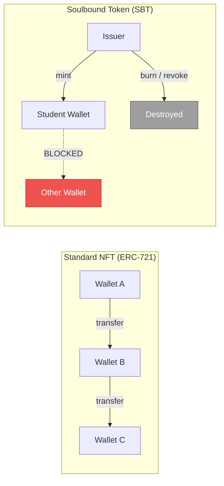
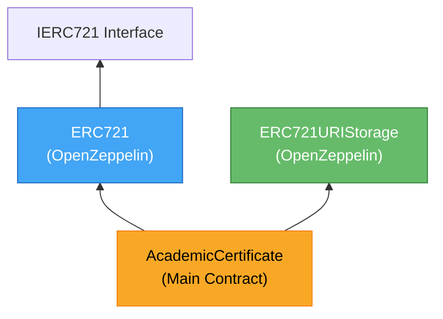
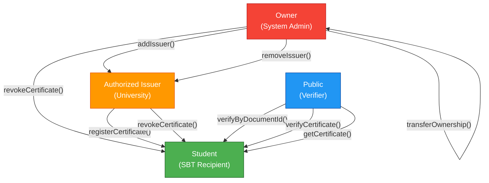
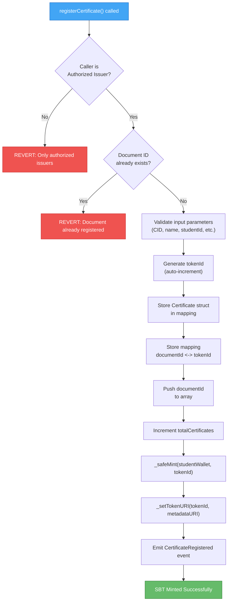
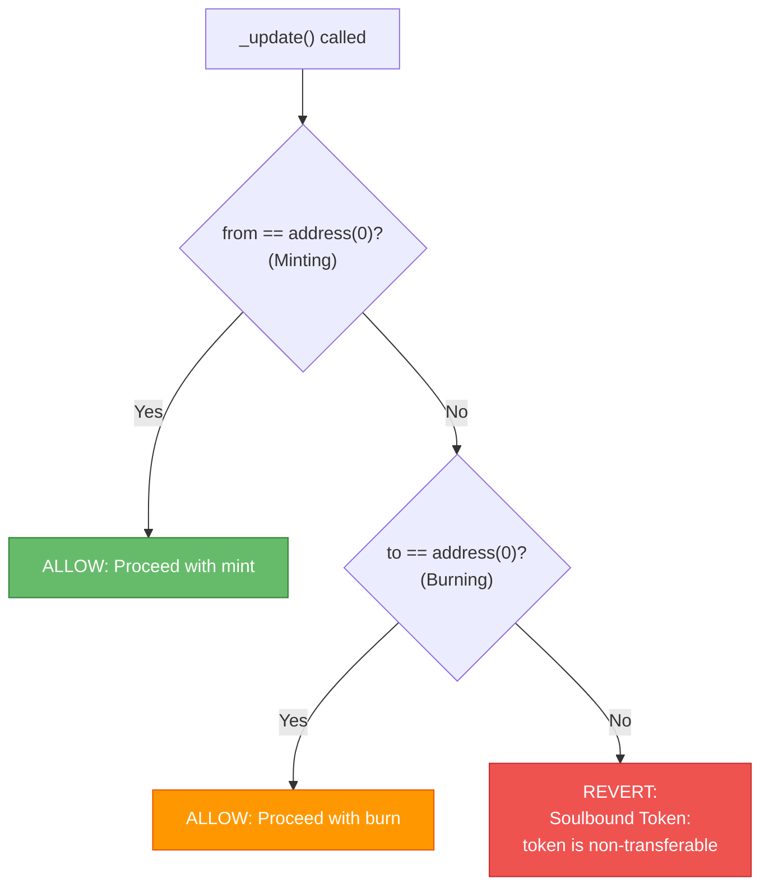

# Smart Contract

> Core contract of the blockchain-based academic credential verification system.
> Implemented as a **Soulbound Token (SBT)** — a non-transferable NFT.

---

## What is a Soulbound Token (SBT)?

A Soulbound Token is a specialized variant of the NFT standard (ERC-721) with strict transfer restrictions:

- **Non-transferable** between wallets
- **Non-approvable** to third parties
- **Mintable only** by an Authorized Issuer
- **Burnable (revocable) only** by the original Issuer or the Contract Owner

This model fits academic credentials because diplomas and certificates are inherently **bound to their owner** and must never be traded or transferred.



---

## Contract Architecture

### Inheritance



### Certificate Struct

```solidity
struct Certificate {
    string documentId;       // Unique document ID (format: UNIV-YEAR-NUMBER)
    string ipfsCID;          // IPFS Content Identifier (file hash)
    string studentName;      // Student full name
    string studentId;        // Student ID (NIM)
    address studentWallet;   // Student wallet address (SBT recipient)
    string degree;           // Degree level (e.g., Bachelor, Master, Doctorate)
    string major;            // Study program / major
    address issuerAddress;   // Issuing institution wallet address
    string issuerName;       // Issuing institution name
    uint256 issuedAt;        // Issuance timestamp
    bool isValid;            // Validity status (true = active, false = revoked)
    bool exists;             // Record existence flag in storage
}
```

---

## Role Management



| Role | Description | Accessible Functions |
|---|---|---|
| **Owner** | System administrator, contract deployer | `addIssuer`, `removeIssuer`, `revokeCertificate`, `transferOwnership` |
| **Issuer** | Authorized university / institution | `registerCertificate`, `revokeCertificate` (issued certificates) |
| **Student** | SBT recipient, document owner | None (SBT is directly credited to wallet) |
| **Public** | Anyone (verifier) | All `view` functions (on-chain data reading) |

---

## Function Reference

### Write Functions (Require Gas)

| Function | Modifier | Description |
|---|---|---|
| `addIssuer(address, string)` | `onlyOwner` | Adds a new authorized issuer |
| `removeIssuer(address)` | `onlyOwner` | Removes an issuer from the authorization registry |
| `registerCertificate(...)` | `onlyAuthorizedIssuer` | Registers certificate and mints SBT |
| `revokeCertificate(string)` | Issuer / Owner | Revokes certificate and burns SBT |
| `transferOwnership(address)` | `onlyOwner` | Transfers contract ownership |

### Read Functions (View / Non-State-Changing)

| Function | Return | Description |
|---|---|---|
| `getCertificate(documentId)` | `Certificate, tokenId` | Retrieves complete certificate data |
| `verifyByDocumentId(documentId)` | `Certificate, tokenId` | Verification entry point for QR Code scanning |
| `verifyCertificate(documentId, CID)` | `isValid, isMatching, ...` | Deep verification via CID comparison |
| `certificateExists(documentId)` | `bool` | Checks whether Document ID is registered |
| `getCID(documentId)` | `string` | Retrieves the IPFS CID of the document |
| `getAllDocumentIds()` | `string[]` | Retrieves all registered document IDs |
| `getTokenId(documentId)` | `uint256` | Retrieves the token ID for a given document ID |
| `getDocumentId(tokenId)` | `string` | Retrieves the document ID for a given token ID |
| `totalCertificates()` | `uint256` | Returns total registered certificates |

---

## Smart Contract Process Workflows

### Registration (Mint SBT)



### Soulbound Mechanism



---

## Events

| Event | Parameters | Description |
|---|---|---|
| `CertificateRegistered` | documentId, tokenId, ipfsCID, studentWallet, issuerAddress, studentName, studentId, timestamp | Emitted when a new certificate is registered |
| `CertificateRevoked` | documentId, tokenId, revokedBy, timestamp | Emitted when a certificate is revoked |
| `IssuerAdded` | issuerAddress, issuerName, timestamp | Emitted when a new issuer is added |
| `IssuerRemoved` | issuerAddress, timestamp | Emitted when an issuer is removed |
| `CertificateVerified` | documentId, verifier, isValid, timestamp | Emitted when verification is performed |

---

## Getting Started

### 1. Install Dependencies

```bash
cd smartContract
npm install
```

### 2. Run Local Blockchain Node

```bash
npx hardhat node
```

This displays 20 test accounts funded with test ETH. Record the private key of the first account (deployer).

### 3. Deploy Contract

```bash
npx hardhat run scripts/deploy.ts --network localhost
```

Output:
```
===========================================
  DEPLOY SUCCESSFUL!
===========================================
Contract Address: 0x5FbDB2315678afecb367f032d93F642f64180aa3
```

> Copy the `Contract Address` into `backend/.env` and `frontend/.env.local`.

### 4. Authorize Issuer (Optional — handled automatically during deploy)

```bash
npx hardhat run scripts/authorize.ts --network localhost
```

### 5. Run Tests

```bash
npx hardhat test
```

---

## Network Support

| Network | Type | Chain ID | Status |
|---|---|---|---|
| **Hardhat Local** | Development | 31337 | Default |
| **Ethereum Sepolia** | Testnet | 11155111 | Supported |
| **Polygon Amoy** | Testnet | 80002 | Supported |

### Deploy to Testnet

```bash
# Set private key and RPC URL
npx hardhat vars set SEPOLIA_PRIVATE_KEY
npx hardhat vars set SEPOLIA_RPC_URL

# Deploy
npx hardhat run scripts/deploy.ts --network sepolia
```

---

## Dependencies

| Package | Version | Purpose |
|---|---|---|
| `hardhat` | ^3.4.0 | Ethereum development environment |
| `@openzeppelin/contracts` | ^5.6.1 | Standard contract library (ERC-721) |
| `ethers` | ^6.16.0 | Ethereum interaction library |
| `@nomicfoundation/hardhat-toolbox-mocha-ethers` | ^3.0.4 | Hardhat testing plugin |